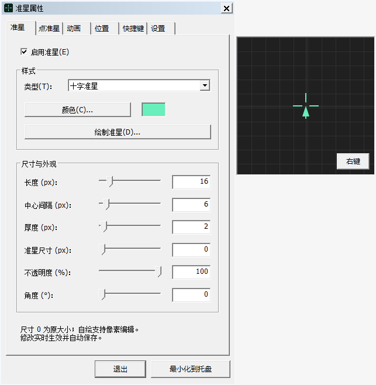
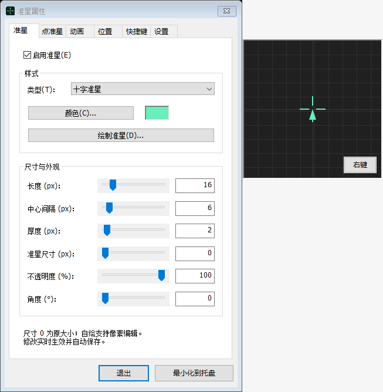

# 本项目全部由 AI 编写

# Hunt Crosshair 便携版 v1.9

Windows 10 / 11 x64 原生外置准星。解压运行 `HuntCrosshair.exe`，无需安装运行环境、服务或驱动，不注入或修改游戏。单文件分发版名为 `HuntCrosshair-v1.9.exe`，功能相同。

v1.9 是本项目的首个公开版本，采用 MIT 许可证。

下载便携包后解压运行 HuntCrosshair.exe。[下载 v1.9](https://github.com/xanbing/HuntCrosshair/releases/tag/v1.9)

升级前先从托盘退出旧版；替换 EXE 并保留同目录的 `HuntCrosshair.ini`，即可沿用颜色、图案、位置及自定义曲线。压缩包不包含个人 INI。

## 原生设置窗口

主窗口使用紧凑的 Windows 原生属性表，包含“准星”“点准星”“动画”“位置”“快捷键”“设置”六页。所有主设置立即生效，停止操作约 300 ms 后自动保存。

底部提供“退出”和“最小化到托盘”，操作时先保存当前设置。关闭设置窗口或在快捷键录入框外按 Esc 后程序仍可在托盘运行。全局显示／位置快捷键立即生效，并按相同规则自动保存。数值输入框内按 Enter 不会退出程序。

唯一的准星预览为带立体边框的独立正方形窗口，停靠在设置窗右侧；颜色按钮旁的带框色块直接显示当前颜色。预览内右下角的“右键”按钮可切换模拟右键状态，再按一次恢复；切换页面后按钮仍在同一位置，收起主窗口时自动结束模拟。

“设置”页提供“默认”和“复古”。默认跟随系统主题；复古保留 Windows 98 风格的经典标题栏、关闭按钮和立体外边框，内部控件同样采用经典绘制。仅裁去经典外框之外多出的空白边距，不更换经典边框或标题栏；画板也继承所选皮肤。切换实时生效并自动保存，不修改 Windows 全局主题、颜色或尺寸设置。字体和系统调色板由当前 Windows 决定，因此复古并非逐像素复制 Win98。标题栏仅保留关闭按钮。

## 准星与像素尺寸

- “准星”页支持十字和自绘准星，颜色、不透明度、角度可调。十字另可调长度、中心间隔和厚度；间隔指中心至每条臂内端的距离。
- “准星尺寸 / px”：`0` 保持原始大小；`1–200` 按未旋转图形或画布的最长边等比缩放，单位为物理像素。缩放同时作用于十字的长度、间隔和厚度，也支持自绘图案，不会修改画布像素数据。
- 点形状支持方形、圆形、尖三角和自绘。“尖三角↑”朝上，尖端本身对准屏幕几何中心加校准偏移；三角形主体向下延伸，不随十字旋转。
- 内置点“点尺寸 / px”可设 `1–64`。自绘点另存显示尺寸，`0` 为原画布大小，`1–200` 按最长边等比缩放；切换内置与自绘点会保留各自尺寸。
- 不透明度 `0%` 完全透明，`100%` 完全不透明。“常态中心点”关闭时，仍可只在右键变点时使用所选点形状。

## 右键动画与曲线

右键效果：保持原样、渐隐隐藏、收拢为中心点。支持按住生效／松开恢复，以及点按切换。进入、恢复时长分别设置，范围 `0–2000 ms`，默认各 `300 ms`；`0 ms` 立即切换。中途松开或再次按下会从当前状态连续过渡。

点准星始终保持设定的形状、尺寸和校准位置。出现与隐藏只改变透明度，并使用所选动画曲线和时长；不会随着准星收缩而移动、缩小或弹大。三角形的尖端也始终停在校准中心。

曲线菜单只有六项：

| 选项 | 内容 |
| --- | --- |
| 线性 | 匀速过渡 |
| 缓入 | Ease In |
| 缓出 | Ease Out |
| 阻尼 | 之前保存的曲线：`cubic-bezier(0.492753623188, 0.327586206897, 0.728260869565, 0.310344827586)` |
| 阻尼2 | 本次保存的曲线：`cubic-bezier(0, 1, 0, 1)` |
| 自定义 | 可继续编辑并保存的曲线，与两个命名预设相互独立 |

跳动和回弹已删除。旧 INI 若选中这两项，会回退线性并保留其他设置和自定义坐标。

阻尼、阻尼2 为固定预设；拖动其控制点时，会复制当前曲线到“自定义”再编辑，原预设不变。点击“恢复自定义”可返回保留的自定义坐标。

三次贝塞尔有四个点：P0=(0,0)、P3=(1,1) 固定，P1/P2 可调。横轴为时间、纵轴为进度。直接在图中拖动 P1/P2；未编辑时保留完整精度，拖动后按 `0.001` 对齐。选中 P1/P2 后，方向键调整 `0.01`，Shift+方向键调整 `0.001`。

“播放动画”只影响界面预览，播放进入、停留 180 ms、恢复，不改变覆盖层或真实右键状态。实际右键输入会取消演示。演示在独立预览窗中播放；实际瞄准锚点使用显示器几何中心和设置的 X/Y 偏移。

## 像素画板

“绘制准星”和“绘制点准星”使用两张独立画布。默认 `20×20`，宽、高各可设 `1–100`。每格为原图一个像素，图形使用对应准星的颜色和不透明度；显示缩放独立于原图尺寸。

左键绘制，右键擦除，也可选择橡皮。画板周围使用系统原生按钮、单选框、复选框、分组框和输入框；只有像素画布与原图预览为自定义绘制。支持整笔撤销／重做、清空、居中调整／裁剪、网格、中心参考线及原图 1:1 预览。输入尺寸后点击“居中调整／裁剪”；缩小会裁剪边缘，可撤销。

画板内的“应用”使新图案立即生效并自动保存，“取消”保留原图。应用和取消均返回仍可操作的主界面；已修正模态窗口关闭时的主窗口激活与恢复顺序。绘图期间覆盖层暂时隐藏，结束后恢复原显示状态。应用自绘点不会自动开启“常态中心点”。

## 几何中心与微调

默认以显示器几何中心定位。1920×1080 的中心位于四个像素交界，标称 1 px 方点通过覆盖率抗锯齿对称分配透明度，实现几何居中，实际影响多个物理像素。

X/Y 偏移支持 `1`、`0.25`、`0.0625 px` 步长。减／加按钮按所选步长调整，小数输入对齐到 `1/16 px`。滑块作整像素粗调并保留小数相位。最终颜色与透明度为 8 位量化，极小、低不透明度变化不一定肉眼可见。

“快捷键”页可分别修改显示／隐藏、打开设置、退出和四个微调方向的全局快捷键。点击输入框后直接按下组合键，支持 Ctrl、Shift、Alt 和常用按键；Tab / Shift+Tab 离开输入框。录入期间暂停全局快捷键，离开后恢复，避免触发正在设置的操作。

每项“清除”可停用对应操作，“恢复默认快捷键”恢复以下组合。重复组合会被拒绝并保留原设置；被其他程序占用或系统保留的组合会提示更换。F12 被 Windows 的调试器保留，不能注册。修改实时生效并自动保存。

| 默认快捷键 | 功能 |
| --- | --- |
| Ctrl + Shift + Alt + 方向键 | 按当前微调步长移动，可按住连续调整 |
| Alt + Shift + X | 显示／隐藏覆盖层 |
| Alt + Shift + S | 打开设置 |
| Alt + Shift + Q | 退出程序 |
| 画板内 Ctrl + Z / Ctrl + Y | 撤销／重做 |

覆盖层鼠标穿透、不抢焦点。关闭主窗口后留在托盘。快捷键被占用时，“快捷键”页会显示对应操作，可修改组合或重新进入录入框后离开以重试注册；托盘仍可打开设置和退出。

## 配置、兼容和构建

设置自动保存到程序旁的 `HuntCrosshair.ini`，复制整个目录即可携带设置。INI v6 保存皮肤、快捷键、像素图、显示尺寸和完整精度自定义坐标，兼容旧版设置；旧配置默认保留当前皮肤及原快捷键。程序目录需可写。

保存失败时，当前设置继续生效，窗口标题会显示“保存失败”。退出前会重试保存；若仍失败，默认保留程序和本次设置，可修复目录写入权限后重试，也可明确选择丢弃未保存修改并退出。

支持窗口和无边框全屏，独占全屏不在本版范围。“仅游戏前台显示”按《猎杀：对决》进程识别；若游戏更改进程名，可关闭此选项。

使用 Zig 0.13.0，在项目目录执行 `./build.ps1 -Tests`。编译器加入 PATH，或放在 `../toolchain/zig-windows-x86_64-0.13.0`。产物为 `build/HuntCrosshair-v1.9.exe`，分发不需要编译器。

运行 `./package.ps1` 可在 `dist` 目录生成便携包、源码包、EXE 和 SHA256 校验文件。

检查包括缩放、固定位置透明度动画、三角尖端、阻尼预设、配置迁移、画板模型、真实模态 API 的应用／取消与主窗口恢复、自动保存、快捷键录入及注册边界、两种原生皮肤切换。属性表快照在当前 100% 缩放下检查，画板另检查了 100%／150% 布局。尚未在《猎杀：对决》实际游戏中验证覆盖兼容性。

## 贡献者

- **xanbing** 需求设计、功能验收与项目维护。
- **Codex** AI 编程、测试和文档编写。[GitHub 账号](https://github.com/codex)

## 许可证

项目源码和自行生成的图标采用 MIT 许可证。Windows 静态运行时的版权及许可随包提供，分发时请一并保留。[项目许可证](LICENSE) · [运行时许可](THIRD_PARTY_NOTICES.md)
